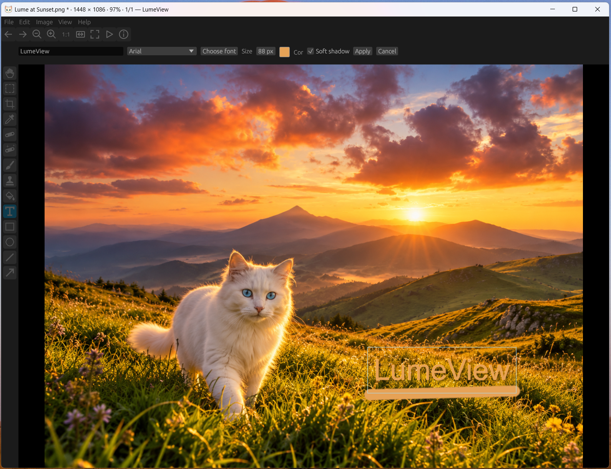

# LumeView

A minimalist image viewer written in Rust, inspired by IrfanView. LumeView focuses on fast folder navigation and simple image cropping for wallpapers, with support for JPEG, PNG, WebP, AVIF, GIF, BMP, TIFF, HEIC, ICO and CBZ comics.



## Download

LumeView is available for **64-bit Windows**. Choose one of these installation options:

- **Microsoft Store:** [Install LumeView from the Microsoft Store](https://apps.microsoft.com/detail/9n0wr4v1nxkf).
- **EXE installer:** Open the [latest GitHub release](https://github.com/flavw/LumeView/releases/latest), download **LumeView-Setup.exe**, and run it. The installer creates a Start menu shortcut and registers LumeView in **Open with**; your default apps are not changed.
- **Manual ZIP:** Open the [latest GitHub release](https://github.com/flavw/LumeView/releases/latest), download **LumeView-0.37.2-Windows-x64.zip**, extract it, and run **LumeView/lumeview.exe**. Keep the `tools` folder beside the executable. No automatic installer or registry changes are performed; file associations are configured manually.

See the [manual installation instructions](docs/manual-installation.md).

## Features

- Fast native decoding of JPEG, PNG and WebP, asynchronous loading and a bounded image cache.
- Minimal text menus; toolbar enabled by default, optional status bar, and a title bar that can be shown or hidden from View. The title-bar preference is saved.
- Original-size viewing, seven zoom modes, fullscreen and slideshow.
- Press **R** to rotate the view 90° clockwise, or use View to rotate clockwise/counterclockwise or reset its orientation. Rotation stays active while browsing during the session and does not change source pixels, saved images or clipboard copies.
- Animated GIF playback with frame timing and loop counts; pause via View.
- SVG/SVGZ viewing through the bundled ImageMagick renderer (rasterized for display).
- Fullscreen title visibility is remembered, with an adjustable translucent black background (75% transparency by default).
- Lume mascot illustrations load on demand in Delete, Rename, Preferences and Shortcuts dialogs.
- Fullscreen menus and toolbar fade in at the top-left corner and hide after three seconds away from the controls.
- Batch resizing by pixels or percentage, with optional aspect-ratio preservation and original-format output. Batch naming supports a base name, digit count and starting number.
- Customizable primary shortcuts under Edit → Preferences → Shortcuts, with conflict validation and default restoration.
- Optional top-left alignment for images larger than the viewport, available under Preferences → Viewing. Press C to switch between centered and top-left zoom; the preference is saved.
- Optional Paint dialog (F12): brush, clone stamp, spot healing, fill, shapes, arrows, text, selections and a hand tool. Supports undo/redo; editing resources load only when used.
- Image effects: black and white, sepia, negative, brightness/contrast, saturation, warm/cool tones and posterization.
- Ctrl+wheel or Alt+wheel zooms around the mouse pointer.
- Wallpaper crops: Free, 1:1, 16:9, 9:16, 10:16, 8:16, original and custom aspect ratios; rule-of-thirds grid and resizable handles.
- Lossless JPEG cropping and rotation through jpegtran. Numbered copies preserve the source; imperfect rotations are rejected.
- Save Image (Ctrl+S) opens the native Windows Save As dialog with JPEG, PNG and WebP filters and an inline 1–100% JPEG/WebP quality selector. PNG remains lossless. JPEG and WebP export default to quality 80.
- Create horizontal or vertical panoramas with ordered images, original sizes and an optional colored gap (zero by default). The result opens as a new document for saving.
- AI generation metadata inspection and copying, including supported Stable Diffusion parameters and ComfyUI JSON stored in PNG, JPEG and WebP metadata.
- Image information, clipboard images, rename with separate extension field, file copying/moving and deletion confirmation.
- CBZ comic reading and navigation through individual ICO images; basic adjustments, undo/redo and unsaved-change confirmation.
- Additional ImageMagick formats have a separate Open filter and are not registered as Windows file associations. PDF, EPS and PostScript are excluded.
- Dark, light, system and customizable neon themes; English, Portuguese, Spanish and French interfaces.

## Quick controls

| Key | Action |
| --- | --- |
| Left / Right | Previous / next image |
| Ctrl+O | Open an image |
| Enter / F / left double-click | Toggle fullscreen |
| 1–7 | Choose a zoom mode; retained while navigating |
| Ctrl or Alt + mouse wheel | Zoom |
| I | Image information and AI metadata |
| P | Preferences |
| C | Toggle centered / top-left zoom alignment |
| F2 | Rename |
| Ctrl+S | Save dialog |
| Ctrl+P | Windows Print Pictures |
| S / W / Q | Export JPEG / WebP / PNG |
| Page Down / Page Up | Scroll down / up; press again at the boundary to change image |
| Ctrl+Y | Apply the crop |
| Delete / Shift+Delete | Recycle / permanently delete, with confirmation |
| F1 | All shortcuts |

Without modifiers, the mouse wheel navigates images or scrolls vertically in the width-fit reading mode. The default zoom fits large images to the window without enlarging small ones. Selected zoom modes persist between images; width-fit pages start at the top. Left-click and drag creates a freeform selection in zoom modes 2 and 3 outside fullscreen. Automatic restart at the end of a folder is enabled by default; disabling it shows a restart dialog.

## Build from source

Install Rust and your platform's native build tools, then run:

```sh
cargo build --release --bin lumeview
```

The Windows build also needs a resource compiler (`windres` for the GNU toolchain). The shipped Windows release is tested; Linux support is present in the source but has not yet been validated as a release.

JPEG/PNG/WebP viewing uses native libraries. Additional formats such as AVIF and batch conversion use ImageMagick on demand; lossless JPEG operations use jpegtran. These tools are bundled with the Windows installer. For a source build, install them on PATH, place them under `tools/`, or set `LUMEVIEW_MAGICK` and `LUMEVIEW_JPEGTRAN` to their executable paths. They are not required for native-format navigation.

```sh
cargo test --bin lumeview
cargo clippy --bin lumeview -- -D warnings
```

## Build the Windows EXE installer

After building the release executable, run `powershell -File installer/build.ps1`. Place the ImageMagick and jpegtran distributions under `tools/` first. The script creates `LumeView-Setup.exe`; `/S` enables silent installation. See [installer exit codes](installer/STORE-INSTALLER.md).

## License and AI assistance

LumeView's own source code and assets are dedicated to the public domain under **CC0 1.0 Universal**. See [LICENSE](LICENSE). Third-party libraries and bundled tools retain their respective licenses; see [THIRD_PARTY_LICENSES.txt](THIRD_PARTY_LICENSES.txt) and their accompanying notices.

This project was programmed with AI assistance. AI tools were also used to create the cat icon. LumeView is an independent project and is not affiliated with IrfanView.
